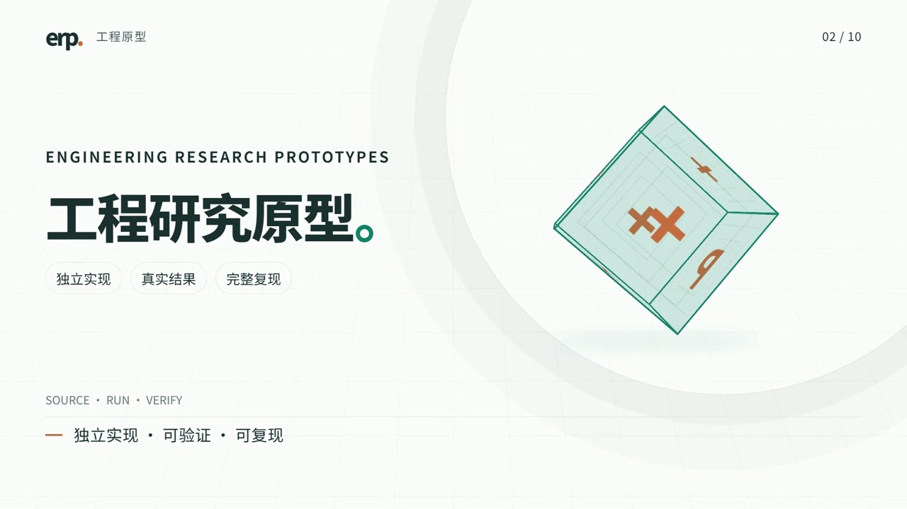

# Engineering Research Prototypes · 工程研究原型

把灵感做成可运行、可核对、可复现的工程原型。

An independent collection of engineering prototypes, with source, reproducible
entry points, measured results, and explicit environment/data requirements.

**[在线成果总览](https://yuguo-jack.github.io/engineering-research-prototypes/)** ·
[▶ 观看工程介绍 · 30 秒](https://yuguo-jack.github.io/engineering-research-prototypes/?v=player3#intro-video) ·
[组织规则](CONTRIBUTING.md) ·
[复现等级](docs/REPRODUCIBILITY.md) · [收录与发布](docs/PUBLISHING.md) ·
[新增成果模板](_templates/project/README.md)

每个 `projects/<id>/` 是一个独立成果，拥有自己的源码、
依赖、构建入口、结果和说明；复制单个目录即可进行该成果的工作。

[](https://yuguo-jack.github.io/engineering-research-prototypes/?v=player3#intro-video)

## 已收录成果

<!-- PROJECTS:START -->
| 成果 | 范围 | 状态 | 入口 |
|---|---|---|---|
| [圆柱绕流 · 单核有限体积求解](projects/cylinder-flow/README.md) | 计算流体 | 已归档 | [复现](projects/cylinder-flow/REPRODUCE.md) · [结果](projects/cylinder-flow/RESULTS.md) |
| [M6 机翼 · MPI 并行流动求解](projects/m6-wing/README.md) | 计算流体 | 已归档 | [复现](projects/m6-wing/REPRODUCE.md) · [结果](projects/m6-wing/RESULTS.md) |
<!-- PROJECTS:END -->

时间、精度和平台信息以各项目 `RESULTS.md` 为准。历史正式测量、本次本地检查和
外部给定参考分别标注；给定参考与本机结果不自动构成同机性能比较。

## 从这里开始

1. 点击[在线成果总览](https://yuguo-jack.github.io/engineering-research-prototypes/)浏览成果，无需下载仓库或安装环境。
2. 阅读所选成果的 `README.md`，再按 `REPRODUCE.md` 检查环境、编译和运行。
3. 仅想核对已保存结果时，执行项目内的 `python reproduce.py verify-results`。

以下命令用于下载源码、复现和维护；本地预览供修改页面时使用。

```powershell
git clone https://github.com/yuguo-Jack/engineering-research-prototypes.git
cd engineering-research-prototypes
python -m pip install -r requirements.txt
python tools/check_repo.py --release
python tools/catalog.py --check
python tools/preview.py --port 8765
```

本地开发预览地址为 `http://127.0.0.1:8765`；退出时按 Ctrl+C。
仓库维护工具使用 Python 3.10+ 和 Git；根目录依赖仅用于文档生成和元数据检查。
各原型运行依赖由各自目录独立声明，不需要为数值求解安装这些文档工具。

```text
projects/<id>/       独立成果：代码、环境、复现方法、结果、来源
_templates/project/  新成果模板
site/                由项目元数据生成的展示页面及静态资源
media/product-intro/ 视频源工程、生成方法与 video/ 播放成品
tools/               目录生成、新成果创建和仓库检查工具
schemas/             项目元数据约定
docs/                复现、资料与发布约定
.github/workflows/   仓库检查和不依赖外部算例的数值测试
```

## 新增一个成果

```powershell
python tools/new_project.py my-prototype --title "我的工程原型" --domain robotics
# 填写项目说明、依赖、数据要求、结果和 project.json
python tools/catalog.py
python tools/check_repo.py
```

可使用 `cfd`、`signals`、`robotics`、`embedded`、`controls`、`other` 等领域标签。
新项目默认为草稿，验证通过后再更新状态。不要把未来方向伪装成已完成成果。

## 资料与授权

见 [资料与授权说明](docs/MATERIALS.md) 和各成果的 `LICENSE.md`。
原始竞赛输入与参考文件按其来源授权管理，通过项目的数据清单从本地授权归档导入，
不随 Git 仓库分发。当前保留各材料权利，未授予统一的开源许可。

## 欢迎提需求与支持

**有工程问题或原型想法，欢迎来提需求！** 想验证的算法、希望做出的原型、工具适配，
或者复现中遇到的问题，都欢迎交流。一句话的想法也可以，后续再一起补充细节。

可以聊聊你想解决什么问题、手头有哪些数据或设备，以及希望得到什么结果。
大家的真实需求，会帮助这里选择下一项值得做的工程原型，也欢迎一起参与共建。

**[提一个工程需求 ↗](https://github.com/yuguo-Jack/engineering-research-prototypes/issues/new?template=research-request.yml)** ·
[看看已有需求](https://github.com/yuguo-Jack/engineering-research-prototypes/issues)

### 支持项目维护（自愿）

如果这里的原型对你有帮助，欢迎通过支付宝自愿打赏，支持后续维护与新原型探索。

<a href="https://yuguo-jack.github.io/engineering-research-prototypes/assets/support/alipay.jpg"></a>

点击二维码查看大图，或保存后用支付宝识别。打赏完全自愿，欢迎大家自由提需求、交流和共建。
