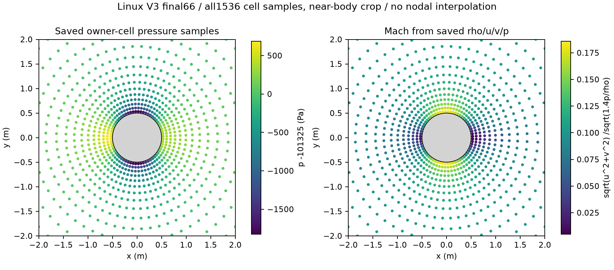

# 圆柱绕流 · 单核有限体积求解

单核 CPU、C++17、无需 MPI。66 步收敛；九次正式中位求解时间 0.223238375 s；Cp RMSE 0.0003429041。



## 入口

[完整复现](REPRODUCE.md) · [结果与限制](RESULTS.md) · [输入准备](DATA.md) ·
[授权状态](LICENSE.md) · [源码身份](SOURCE_MANIFEST.json)

在本目录执行：

```powershell
python reproduce.py doctor
python reproduce.py build --jobs 2
python reproduce.py test
python reproduce.py verify-results
```

构建、数值测试和已保存结果核对不需要外部算例。完整工况需要按 DATA.md 导入原始初场。
`build/`、`runs/` 和 `data/external/` 是本地工作目录，不进入 Git。

## 当前验证

历史工况结果与本次包装后的本地检查分别记录在 `results/metrics.json` 和
`results/VALIDATION.json`。测试通过的范围以验证记录为准，历史性能不由当前平台保证。
本成果可单独复制使用，无需导入仓库根目录的 Python 工具或其他成果。
