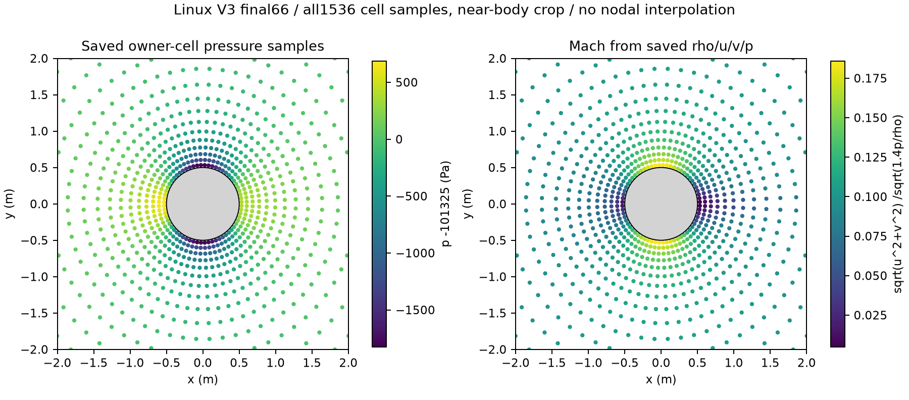
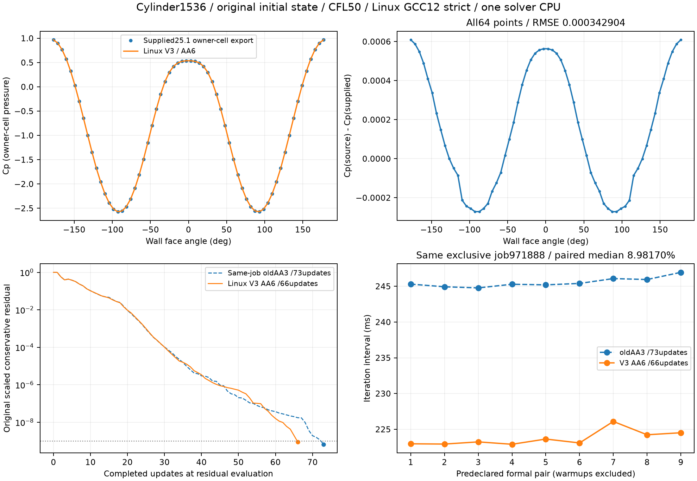

# 圆柱绕流结果

## 历史正式结果

| 指标 | 独立程序 | 给定参考 |
|---|---:|---:|
| 迭代步数 | 66 | 118 |
| 求解迭代耗时 | 九次正式中位 0.223238375 s | 0.651 s |
| Cp RMSE | 0.000342904098 | 指定压力取样参考 |
| Cd | 0.071652545499 | 相对差 +0.0016670986973% |

参考为赛方给定 Fluent 25.1 日志，未在相同目标机器重新执行；65.708391% 只是两份
记录的说明性耗时降幅，不称为同机正式加速比。

正式样本保存在 results/raw/formal-01 至 formal-09；`summary.json` 的 iteration_seconds
用于中位数计算。history.csv 最后一行是迭代记录时间戳，不替代最终汇总计时。
结果文件原始身份见 results/PROVENANCE.json，计算源码身份见 SOURCE_MANIFEST.json。

历史正式环境为 Linux x86-64 / Hygon 7581B、GCC 12.2、CMake 3.26.5，求解使用一个
物理核、不运行 MPI。当前 Windows 可移植构建的功能验证与历史 Linux 计时分别记录。

## 关键展示

第二张归档图的下排包含本原型与早期 AA3 版本的内部配对比较；图中的 8.98170%
属于该内部比较，并非相对赛方 Fluent 参考的加速比。它作为归档图保留，不混入上表口径。

图表对应归档工况；压力取样和参考条件按归档方法解释。不能从单个算例推出所有网格
或工况的精度和速度。当前本地源码验证单独记录在 results/VALIDATION.json，未替换上述样本。
