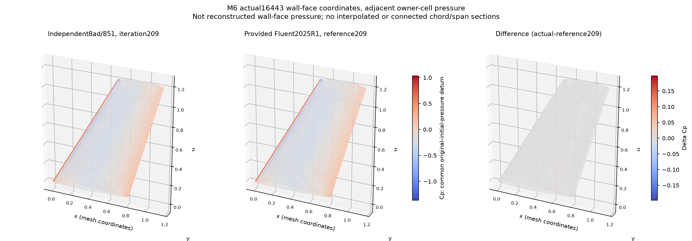
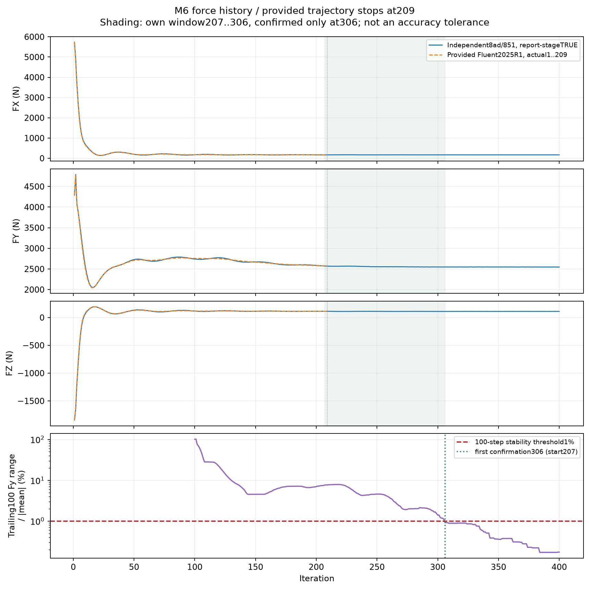
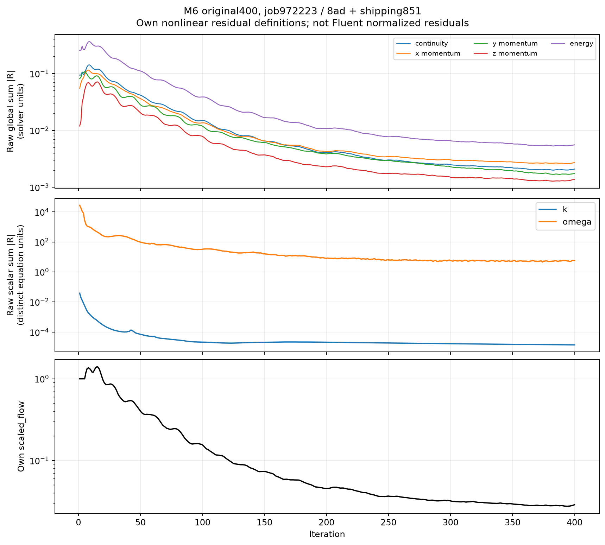

# M6 机翼结果

## 历史正式运行：32 MPI，400 步

| 里程碑 | 步数 | 累计求解耗时 |
|---|---:|---:|
| 自身首个百步稳定窗的起点 | 207 | 181.368853419 s |
| 与给定步数相同的辅助时点 | 209 | 183.052494189 s |
| 稳定窗确认 | 306 | 265.477140800 s |
| 固定完整运行 | 400 | 344.673694265 s |

百步窗口为 207–306，运行到 306 步才可确认；不能把 207 步耗时说成已确认稳定。
给定参考的稳定窗起点为 209，耗时 187.955 s。3.504108% 是起点口径的跨来源记录降幅，
不构成同机正式加速比，也不能用它比较到 306 或 400 步的时间。

完整积分时间取最终 summary.json；history.csv 第 400 行的 344.673661795 s 是该行
写入时的时间戳，两者保留各自口径，不能为通过检查而改写原值。

## 相对给定第 209 步的数值对照

| 自研时点 | Cp RMSE | Fx 相对差 | Fy 相对差 | Fz 相对差 |
|---|---:|---:|---:|---:|
| 窗口起点 207 | 0.0044814072 | -1.297971% | -0.231075% | +0.450211% |
| 209 | 0.0044695033 | -1.205241% | -0.191404% | +0.220525% |
| 窗口确认 306 | 0.0047052739 | -0.689868% | -1.026167% | -1.313934% |
| 400 | 0.0049028657 | -0.903105% | -1.080885% | -1.850496% |

压力为壁面相邻 owner-cell 取样，并非重构的壁面面值。题面自身百步 Fy 稳定性阈值
为 1%；统一的参考压力/三力硬误差容限未公布，因此不预先声明官方验收、分数或所有
工况的精度达标。详细对照保存在 results/accuracy-summary.csv。

## 关键展示

results/raw/ 保存完整 400 步 history、流动与湍流线性审计、stdout 和最终 summary。
归档环境为 Linux/Hygon 7581B，GCC 9.3 与 OpenMPI 4.1.5，源版本固定在项目元数据。
本次本地构建和数值测试另见 results/VALIDATION.json；本轮未在原目标节点重跑完整性能测量。
